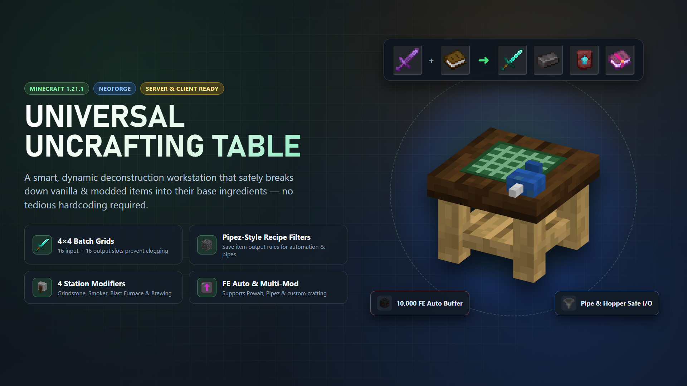
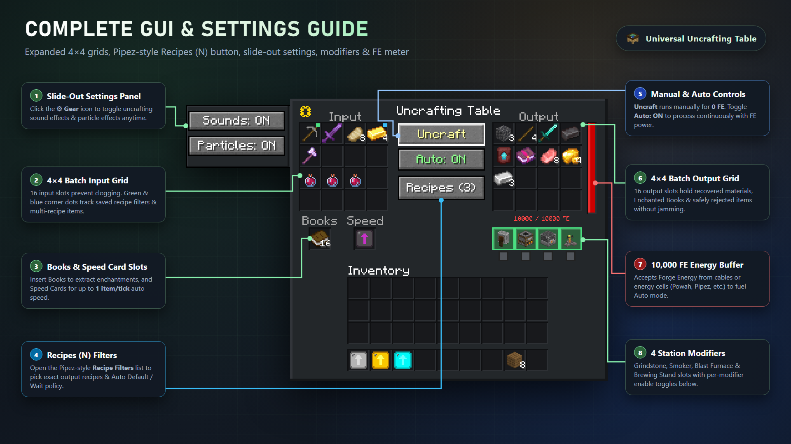
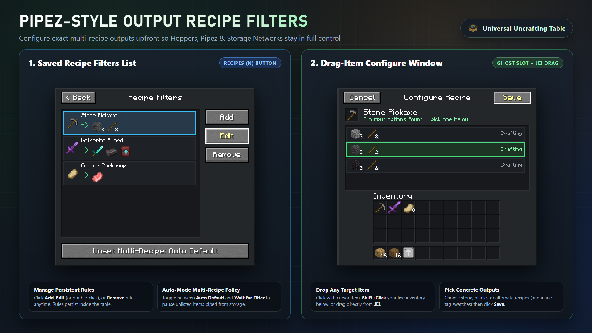
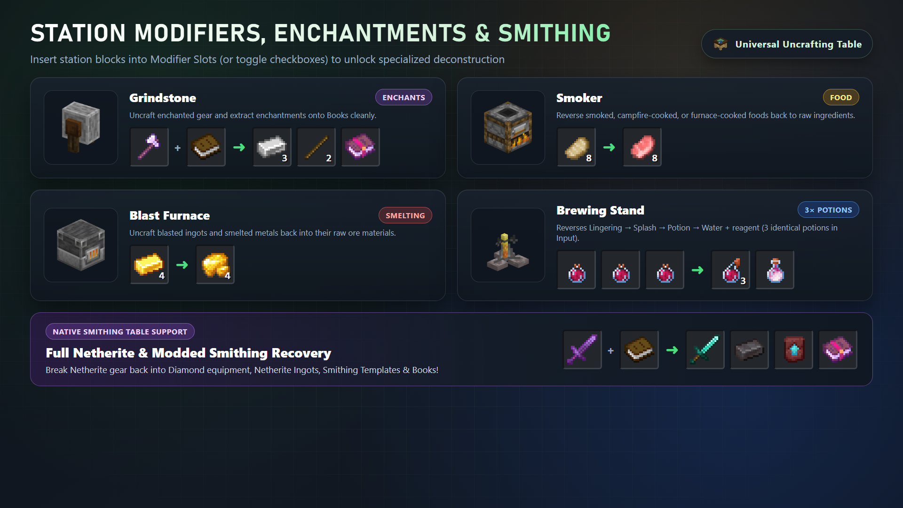
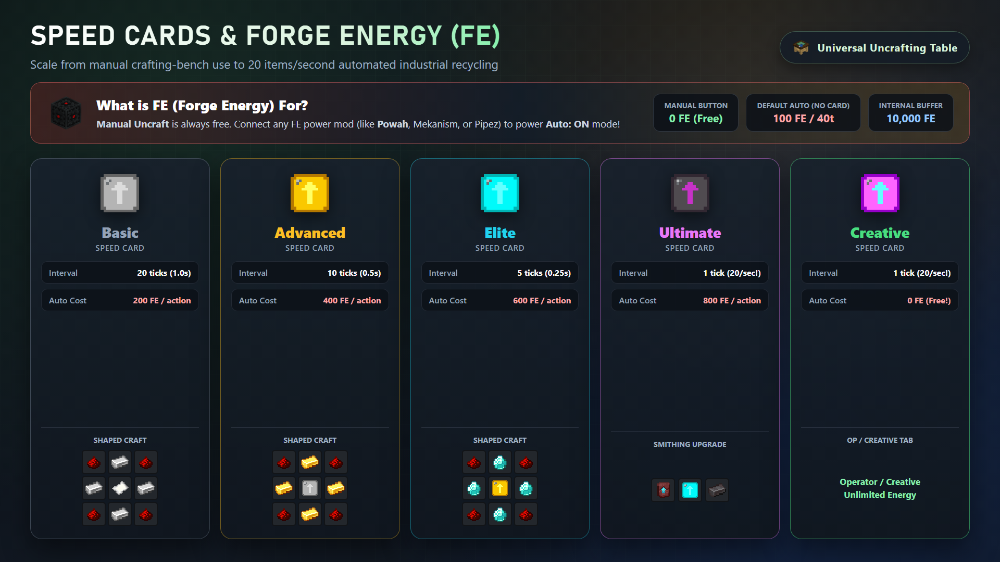

# Universal Uncrafting Table



A smart, dynamic deconstruction workstation for **Minecraft 1.21.1 (NeoForge)** that safely breaks vanilla and modded items back into their base ingredients without tedious hardcoding.

- **CurseForge:** [Universal Uncrafting Table](https://www.curseforge.com/minecraft/mc-mods/universal-uncrafting-table)
- **Minecraft Version:** `1.21.1`
- **Mod Loader:** `NeoForge` (`21.1.200+`)
- **License:** MIT

---

## Features

### Expanded 4×4 Batch Grids (`38` Total Slots)
- **4×4 Input Grid (`16` slots)** & **4×4 Output Grid (`16` slots)** prevent clogging during multi-item recycling and modded multi-ingredient outputs.
- Automatic migration of legacy `1.0.0` (24-slot) world saves into the `38`-slot layout.



### Pipez-Style Output Recipe Filters (`Recipes (N)`)
Full player control over multi-recipe items — even when piped automatically from storage systems:
- **Saved Rules List (`Recipe Filters`):** Click **`Recipes (N)`** to **`Add`**, **`Edit`** (or double-click), or **`Remove`** persistent per-item output rules.
- **Drag-Item Configure Window (`Configure Recipe`):** Place any item into the Ghost Slot (cursor click, `Shift + Click` from live player inventory, or **drag directly from JEI**) and pick the exact output materials (e.g., Cobbled Deepslate vs. Cobblestone vs. Blackstone) or alternate crafting sources.
- **`Unset Multi-Recipe` Policy Toggle:** Switch between **`Auto Default`** (uses the default recipe automatically) and **`Wait for Filter`** (pauses unlisted multi-recipe items piped from storage until you configure a rule).



### Station Modifiers, Enchantments & Smithing
- **Grindstone + Books:** Extracts enchantments cleanly onto **Enchanted Books** while recovering the base ingredients.
- **Smoker:** Reverses smoked, campfire-cooked, and furnace-cooked foods into raw ingredients.
- **Blast Furnace:** Reverses smelted and blasted ingots back into raw ores.
- **Brewing Stand:** Reverses sets of `3` identical potions (`Lingering → Splash → Potion → Base + Reagent`).
- **Native Smithing Recovery:** Breaks Netherite gear and modded `SmithingTransformRecipe` items cleanly back into base gear, ingots, and templates.
- Individual checkbox toggles under each modifier slot allow bypassing modifier requirements when desired.



### Speed Cards & Forge Energy (`FE`)
- **Manual `Uncraft` button is always `0 FE` (free).**
- **Auto Mode (`Auto: ON`)** accepts **Forge Energy (`FE`)** (e.g., from **Powah**, Pipez, or Mekanism cables) into its `10,000 FE` internal buffer:
  - **No Card:** `100 FE` / `40 ticks`
  - **Basic Speed Card:** `200 FE` / `20 ticks`
  - **Advanced Speed Card:** `400 FE` / `10 ticks`
  - **Elite Speed Card:** `600 FE` / `5 ticks`
  - **Ultimate Speed Card:** `800 FE` / `1 tick`
  - **Creative Speed Card:** `0 FE` / `1 tick`



### Automation, Mod Compatibility & Exploit Safety
- **Pipe & Hopper Safe Capabilities:** External automation can only insert into Input (`0–15`) & Book (`32`) slots and extract from Output (`16–31`), keeping Speed Cards and Modifiers safe.
- **Universal & Custom Recipe Support:** Resolves Vanilla recipes, modded custom `RecipeType`s, `SizedIngredient`s, `Stonecutting`, deterministic custom outputs, and **Iron's Gems 'n Jewelry** (`irons_jewelry:jewelry_data`).
- **Automated Station Modifier Feedback & Gating:** Grindstone, Smoker, Blast Furnace, and Brewing Stand slots highlight when occupied, while gating enchanted gear, cooked/alloy-smelted foods, blasted ores, and 3-bottle potion sets cleanly.

---

## Building & Running Tests

Requirements: **Java 21+** (and PowerShell on Windows for `scripts/run_automated_tests.ps1`).

```bash
# Build mod JAR (also runs JUnit 5 tests)
./gradlew build

# Run full automated Vanilla verification (JUnit + 16 GameTests + 1,495-item sweep + JAR build)
./gradlew verifyAllVanilla

# Run JUnit 5 unit & compatibility tests only
./gradlew test

# Run NeoForge in-world GameTest suite
./gradlew runGameTestServer

# Run automated Client GUI & cursor-latency verifier (launches client, tests UI, exits cleanly)
./gradlew runClient -PclientAutoTest=true

# Run normal playable client with JEI
./gradlew runClient
```

One-command local + ATM10 automated test suite (runs Vanilla JUnit/GameTests, live Client GUI/render test, and separate ATM10 full-pack registry sweep cleanly without touching your saves):

```powershell
powershell -ExecutionPolicy Bypass -File scripts\run_automated_tests.ps1 -Suite All -InstallToAtm10
```

In-game commands:
- `/testuncrafting` — Runs the full item + Iron's Gems 'n Jewelry pattern sweep across every registered item (`uncrafting_test_report.txt`; also auto-runs on world load for worlds with `test` in the level name or `-Duncrafting_table.autoSweepOnWorldLoad=true`).
- `/testuncraftinggui` — Runs the live GUI interaction, Pipez recipe filter, and cursor render speed check in-game (`uncrafting_client_gui_report.txt`).
